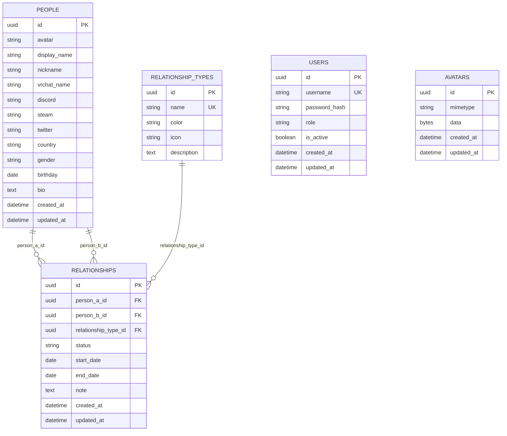

# Database Schema

PostgreSQL, managed via SQLAlchemy models (`backend/app/models/`) and Alembic migrations (`backend/migrations/`).

## ER Diagram



## Tables

### `users`
Login accounts. `role` is `super_admin | member` — both can read/write people, relationships, and relationship types; only `super_admin` can manage other accounts (see `docs/API.md`). `is_active` gates login and is re-checked on every authenticated request (not just at token issuance), so deactivating an account takes effect immediately. Seeded by migration `5490fe2cba1e_add_users_table` from `SUPER_ADMIN_USERNAME`/`SUPER_ADMIN_PASSWORD(_HASH)` env vars; managed afterward via `/api/users`.

### `avatars`
Uploaded profile images, stored as bytes. On disk they'd be wiped by every deploy on the free hosting tier, and the database is the only durable store available; images are capped at 512×512 first, so a whole community is a few megabytes. Rows are immutable — a new upload creates a new row and deletes the old one — which is what makes `/api/avatars/<id>` safe to cache forever.

### `people`
One row per community member. `display_name`, `nickname`, `vrchat_name`, `discord`, `steam`, `twitter`, `country`, `gender` are all indexed for the search/filter features. `gender` is constrained to `male | female | non_binary | other | unspecified` (nullable — optional field).

### `relationship_types`
Lookup table for the 12 built-in relationship types, seeded by migration `73707af94cf9_seed_relationship_types`:

| Name | Meaning | Color | Icon (lucide) |
|---|---|---|---|
| เพื่อน | Friend | `#06B6D4` | `users` |
| พี่น้อง | Sibling | `#6366F1` | `users-round` |
| เป็นแฟนกัน | Dating | `#EC4899` | `heart` |
| แต่งงานแล้ว | Married | `#F43F5E` | `gem` |
| คู่ชีวิต | Partner | `#A855F7` | `handshake` |
| แฟนเก่า | Ex | `#F97316` | `heart-crack` |
| ศัตรู | Enemy | `#DC2626` | `swords` |
| บล็อก | Blocked | `#171717` | `ban` |
| ปิดเสียง | Muted | `#64748B` | `mic-off` |
| กิลด์ | Guild | `#16A34A` | `shield` |
| ครอบครัว | Family | `#0EA5E9` | `home` |
| คนโปรด | Favorite | `#EAB308` | `star` |

`color` is constrained to a `#RRGGBB` hex string via a `CHECK` constraint.

### `relationships`
An edge between two `people` rows (`person_a_id`, `person_b_id`), typed by `relationship_type_id`, with `status` (`active | ended`), an optional `start_date`/`end_date` (used to build each person's timeline), and a free-text `note`.

Constraints:
- `person_a_id <> person_b_id` — no self-relationships.
- `status IN ('active', 'ended')`.
- `end_date >= start_date` when both are set.
- `ON DELETE CASCADE` from `people` — deleting a person removes their relationships.
- `ON DELETE RESTRICT` from `relationship_types` — a type in use can't be deleted.

Indexed on `person_a_id`, `person_b_id`, the `(person_a_id, person_b_id)` pair, `relationship_type_id`, and `status` to keep graph/profile queries fast.

## Migrations

```bash
cd backend
flask db upgrade          # apply all migrations
flask db downgrade -1     # roll back one revision
flask db history          # view the migration chain
```

Four migrations exist so far:
1. `4c948b14b747_initial_schema` — creates `people`, `relationship_types`, `relationships` with all FKs/indexes/constraints.
2. `73707af94cf9_seed_relationship_types` — inserts the 12 built-in relationship types.
3. `5490fe2cba1e_add_users_table` — creates `users` and seeds the first `super_admin` account from env vars.
4. `75aeafbe0ee4_add_avatars_table` — creates `avatars`, moving uploaded images off the filesystem.

> **Note:** These migrations were hand-authored (not `--autogenerate`) because no local/Docker PostgreSQL instance was available in the dev environment used to build this phase. They were reviewed column-by-column against the SQLAlchemy models for correctness, but have **not yet been run against a real PostgreSQL database**. Run `flask db upgrade` (or `docker compose up`, which runs it automatically) against a real Postgres instance and confirm it succeeds before relying on this schema in Phase 3.
